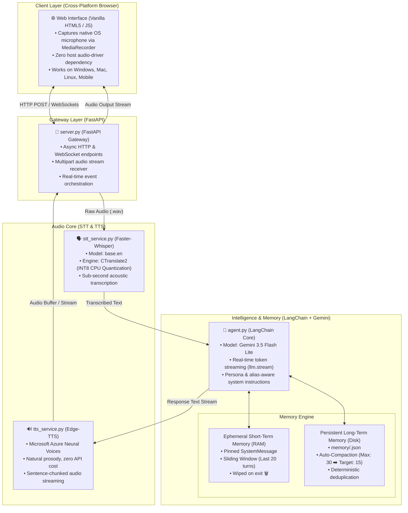

# System Architecture & Technical Design

This document details the complete end-to-end architecture of the **Voice AI Agent** project, tracking its evolution from a containerized Python foundation to a real-time, memory-enabled cascaded voice pipeline.

---

## 🏛️ 1. High-Level Architecture Overview

The system is designed around a **Cascaded Decoupled Voice Pipeline** with **Ephemeral-Session State** and **Persistent Long-Term Memory**.



---

## 🚀 2. System Evolution (Phases Completed)

### Phase 1: Containerized & Isolated Foundation
* **Goal:** Ensure code runs identically across any machine without host dependency conflicts.
* **Architecture:** Multi-stage `Dockerfile` based on `python:3.12-slim` (Debian Linux).
* **Security & Cleanliness:** Enforces non-root execution (`appuser`), disabled byte-code compilation (`PYTHONDONTWRITEBYTECODE=1`), and real-time unbuffered logging (`PYTHONUNBUFFERED=1`).
* **Secret Protection:** Strict `.dockerignore` rules ensuring `.env`, `.venv`, and cache never leak into build layers.

### Phase 2: LangChain Reasoning & Two-Tier Memory
* **The Stateless Problem:** LLMs have zero native memory; every call is independent.
* **Two-Tier Memory Solution:**
  1. **Short-Term Memory (RAM Only):** Active chat turns exist only in memory with a sliding window (`MAX_SHORT_TERM_TURNS = 20`) to prevent context window saturation and token cost inflation.
  2. **Long-Term Memory (Persistent JSON):** User profile facts stored in `memory/<user_id>.json`. Injected on startup directly into the `SystemMessage`.
* **Deterministic Delta Extraction:** On session exit, the model analyzes *only* today's conversation (deliberately excluding the system prompt) to identify *new* facts. Python handles deduplication and appending deterministically, avoiding the **"Telephone Game / Lossy Compressive Drift"** flaw.
* **Auto-Compaction Engine:** When stored facts exceed 30 items, a compaction pass synthesizes and consolidates memory down to 15 core facts, retaining user identity (e.g. Gojo/Sorcerer persona, tech stack) while pruning stale details.
* **Streaming Response:** Migrated from blocking `llm.invoke()` to `llm.stream()` for real-time word-by-word terminal streaming.

### Phase 3: Audio Core & Cross-Platform Voice Gateway (Current)
* **The Hardware Passthrough Problem:** Passing microphone/speaker hardware directly into Docker (`/dev/snd`, ALSA) breaks across Windows WSL2 and macOS.
* **The Browser-Mediated Audio Solution:** The user opens `http://localhost:8000`. The browser uses standard Web Audio APIs (`navigator.mediaDevices.getUserMedia`) to record audio natively on the host OS.
* **STT Engine (`faster-whisper`):** 
  - Rewritten Whisper running on **CTranslate2** with **INT8 quantization**.
  - Uses `base.en` (~145 MB). Delivers **4x faster inference** than standard PyTorch Whisper on standard CPU without requiring an Nvidia GPU.
  - Resolved PyAV compatibility by pinning `av<18` to support `faster-whisper`'s container decoding.
* **TTS Engine (`edge-tts` in `tts_service.py`):**
  - Uses Microsoft's **Edge Neural Voice** (`en-US-GuyNeural`) over WebSocket with zero API key or billing required.
  - Streams synthesized MP3 chunks from Edge Read Aloud, buffers them in memory, and returns raw `audio/mpeg` bytes via `POST /synthesize`.
  - Browser plays the MP3 natively via `new Audio()` and `URL.createObjectURL()`, keeping host speaker playback 100% Docker-portable.

> [!NOTE]
> **Understanding "Model" vs. "Engine" (The Ollama Analogy):**
> * **Model (`base.en`):** The static file of trained neural weights (just like a `llama3` weights file or an Android `.dex` file). It cannot run on its own.
> * **Engine (`CTranslate2`):** The compiled C++ runtime that loads those weights and executes the intensive matrix math on your device's CPU.
> * **Analogy:** Just like **Ollama** runs local LLM weights (via `llama.cpp`) on your laptop, **CTranslate2** is the dedicated local C++ engine that runs Whisper speech models on your laptop without needing a cloud server or GPU.

---

## 📁 3. Directory Layout & Module Responsibilities

```text
langchainAgent/
├── docs/
│   ├── ARCHITECTURE.md     # Comprehensive system architecture document (This file)
│   └── voice_agent_flow.png # Visual system workflow diagram
├── memory/
│   └── praveen.json        # Single persistent user facts file (JSON array)
├── static/
│   ├── index.html          # Web UI structure (links CSS and JS)
│   ├── styles.css          # Dark-mode styling & mic button animations
│   └── app.js              # Browser MediaRecorder, fetch(), & TTS playback
├── .dockerignore           # Excludes secrets, venv, and cache from images
├── .env.example            # Environment variable template
├── agent.py                # Core LangChain agent with Two-Tier memory engine
├── BUILD_AND_RUN.md        # Complete execution, CLI, and web server run guide
├── Dockerfile              # Multi-platform Linux container definition
├── docker-compose.yml      # Container orchestration configuration
├── README.md               # Project overview
├── requirements.txt        # Pinned project dependencies
├── server.py               # FastAPI web gateway & Web Audio testing UI
├── stt_service.py          # Faster-Whisper speech-to-text service wrapper
└── tts_service.py          # Edge-TTS text-to-speech service wrapper
```

---

## 🎯 4. Key Architectural Decisions & Why We Chose Them

| Architectural Decision | Chosen Strategy | Why It Was Chosen Over Alternatives |
| :--- | :--- | :--- |
| **Audio Transport** | Browser Web Audio via FastAPI | Eliminates host OS sound driver incompatibilities inside Docker containers. |
| **STT Engine** | `faster-whisper` (CTranslate2 INT8) | 4x faster CPU inference, half the RAM usage compared to standard PyTorch Whisper; runs offline with zero API cost. |
| **TTS Engine** | `edge-tts` (`en-US-GuyNeural`) | Natural Microsoft neural voice quality with zero API cost and zero local CPU/RAM overhead compared to heavy local TTS models. |
| **PyAV Decoding** | Pinned `av<18` | Bypasses the PyAV 19+ `metadata_errors` deprecation issue while maintaining stable audio decoding. |
| **Memory Storage** | Native JSON Array (`.json`) | Eliminates fragile markdown bullet parsing while maintaining human readability and instant Python `json.loads` access. |
| **Memory Extraction** | Programmatic Delta Merging | Never trusts an LLM prompt to re-summarize past summaries; code deterministically appends new facts to prevent fact loss over time. |
| **Turnaround Latency** | Sliding Context + Streaming | Keeps prompts under token budgets and enables immediate token streaming via `llm.stream()`. |

---

### 🎙️ Deep Dive: Why We Chose Our STT Architecture

> **Architecture Summary:** For Speech-to-Text, the system runs **OpenAI's Whisper model locally** using the **CTranslate2 C++ engine** with **INT8 quantization**, achieving sub-second transcription on standard CPU without requiring a GPU.

| Design Choice / Consideration | Why We Chose This Solution |
| :--- | :--- |
| **Why not standard OpenAI Whisper (PyTorch)?** | Standard OpenAI Whisper relies on PyTorch, which is resource-heavy and sluggish on CPUs. `faster-whisper` uses CTranslate2 (a dedicated C++ runtime) for 4x faster execution and 50% less RAM footprint. |
| **Why INT8 Quantization?** | It compresses 32-bit floating-point weights into 8-bit integers (`int8`). This drastically slashes CPU cycles and memory bandwidth with virtually zero loss in transcription accuracy. |
| **Why run STT locally instead of a Cloud API?** | Zero API cost, lower end-to-end latency, and complete privacy (user audio is decoded on-premise and never transmitted to external third-party speech APIs). |
| **Model vs. Engine Separation** | The **Model** (`base.en`) is the static file of neural weights (the brain). The **Engine** (`CTranslate2`) is the C++ program that actually loads those weights and executes the math on CPU registers (just like **Ollama** runs local LLM weights via `llama.cpp`). |
