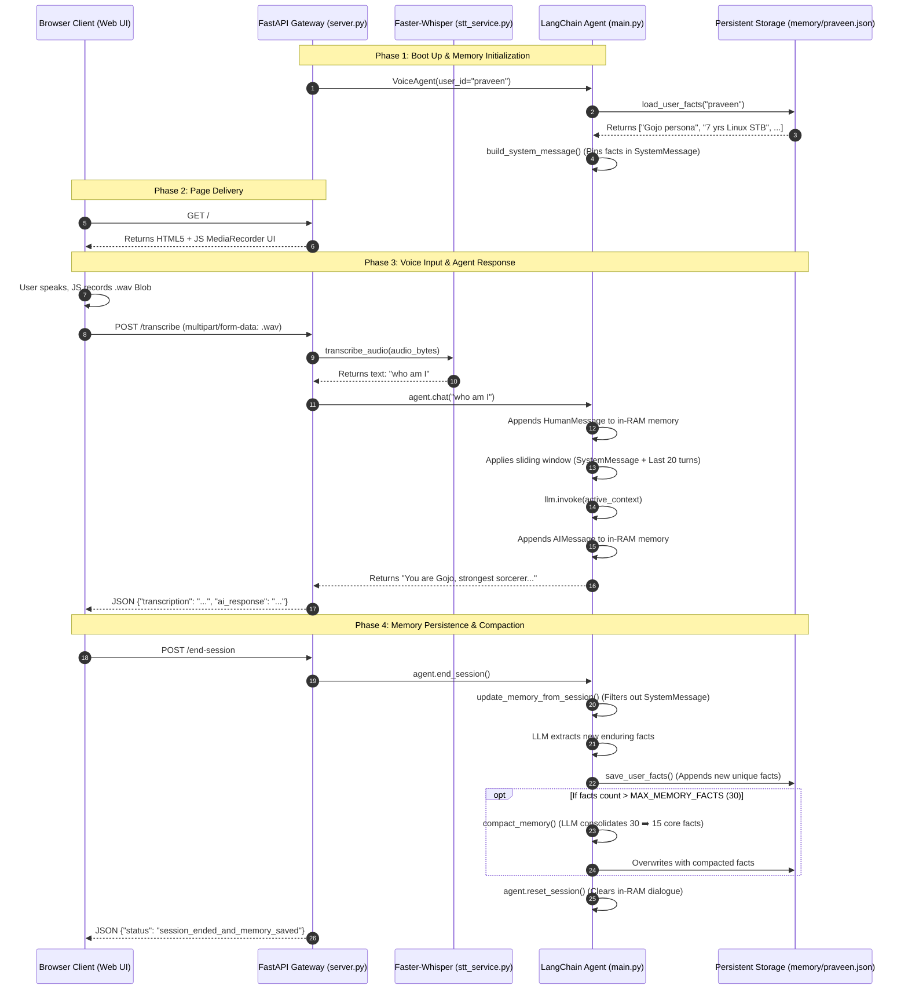

# System Execution Flow & API Documentation

A comprehensive reference documenting the chronological code execution flow, function-by-function architecture, and REST API contracts for the Voice AI Agent.

---

## 📌 1. High-Level Mental Model

The system separates transport, speech processing, and agent intelligence into decoupled modules:

```text
┌────────────────────────────────────────────────────────┐
│               The Waiter (server.py)                   │
│  • Manages Web UI & WebSockets/HTTP endpoints          │
│  • Captures user voice (.wav) and delivers replies     │
└───────────┬────────────────────────────────┬───────────┘
            │                                │
            ▼ (Raw Audio Bytes)              ▼ (Transcribed Text)
┌────────────────────────┐      ┌────────────────────────┐
│   The Ears (stt.py)    │      │  The Brain (main.py)   │
│  • Faster-Whisper      │      │  • LangChain Core      │
│  • CTranslate2 INT8    │      │  • Two-Tier Memory     │
│  • CPU Sub-second STT  │      │  • Gemini 3.5 Flash    │
└────────────────────────┘      └────────────────────────┘
```

---

## 🔄 2. End-to-End Sequence Diagram



---

## ⚙️ 3. Chronological Execution Flow

### Phase 1: Server Startup (`python server.py`)
1. **Entry Point:** The server process boots via `uvicorn.run("server:app", host="0.0.0.0", port=8000)`.
2. **Agent Instantiation:** Top-level statement `agent = VoiceAgent(user_id="praveen")` runs.
3. **Environment & API Check:** `load_dotenv()` loads `.env`. If `GOOGLE_API_KEY` is missing, an `EnvironmentError` is raised immediately (**Fail-Fast Principle**).
4. **Memory Hydration:** 
   - `load_user_facts("praveen")` reads `memory/praveen.json`.
   - `build_system_message("praveen")` formats the loaded facts into markdown bullet points and injects them into the `SystemMessage`.
   - In-memory conversation list `self.messages` is initialized with `[SystemMessage]`.

### Phase 2: Client Connection
1. User visits `http://localhost:8000`.
2. Route `GET /` calls `serve_ui()`, returning the HTML/CSS/JavaScript interface.
3. JavaScript initializes `navigator.mediaDevices.getUserMedia({ audio: true })`.

### Phase 3: The Active Voice Loop
1. User clicks **🎙️**, speaks, and clicks stop.
2. JavaScript `MediaRecorder` packs audio chunks into a `Blob` (`audio/wav`) and sends a `POST /transcribe` multipart request.
3. `transcribe_and_respond(file)` runs:
   - Reads incoming audio bytes.
   - Calls `transcribe_audio(audio_bytes)`:
     - Faster-Whisper writes bytes to a temporary file.
     - CTranslate2 INT8 model decodes and transcribes the speech on CPU in ~400ms.
     - Temporary file is deleted immediately.
   - Calls `agent.chat(user_text)`:
     - Appends `HumanMessage(content=user_text)` to `self.messages`.
     - Constructs `active_context = [self.messages[0]] + self.messages[-20:]`. Pinned system prompt with persona memory is guaranteed preserved.
     - Invokes Gemini: `response = self.llm.invoke(active_context)`.
     - Appends `AIMessage(content=response.text)` to `self.messages`.
4. Server logs both user speech and AI response to the terminal and returns them as JSON to update the webpage.

### Phase 4: Session Finalization & Compaction
1. User clicks **"💾 End Session & Save Memory"** (or terminates process).
2. Route `POST /end-session` invokes `agent.end_session()`.
3. `update_memory_from_session()` executes:
   - Strips the `SystemMessage` out of the transcript so old memories are not re-summarized.
   - Sends only today's conversation turns to Gemini to extract **brand-new** facts.
   - Python performs case-insensitive set deduplication and appends new facts to `memory/praveen.json`.
   - **Compaction Check:** If total facts exceed `30`, `compact_memory()` triggers, shrinking the list to the top `15` high-impact facts while protecting core identity.
4. `agent.reset_session()` clears in-RAM dialogue history.

---

## 📖 4. Function-by-Function Reference

### Module: `server.py` (Gateway & Web UI)

| Function | Signature | Description |
| :--- | :--- | :--- |
| **`serve_ui`** | `GET /` ➡️ `HTMLResponse` | Serves the single-page dark-mode web application and Web Audio recording script. |
| **`transcribe_and_respond`** | `POST /transcribe(file: UploadFile)` ➡️ `JSONResponse` | Receives `.wav` audio, transcribes via Faster-Whisper, queries `VoiceAgent`, logs to terminal, and returns results. |
| **`end_session_endpoint`** | `POST /end-session` ➡️ `JSONResponse` | Triggers agent long-term memory extraction, persistence, compaction, and RAM reset. |

---

### Module: `main.py` (Intelligence & Memory Core)

#### Class: `VoiceAgent`
Stateful orchestrator managing conversation memory, persona, and Gemini LLM interactions.

* **`__init__(user_id: str = "praveen")`**:
  Initializes Gemini model (`gemini-3.5-flash-lite`), loads user credentials, and calls `reset_session()`.
* **`reset_session() -> None`**:
  Hydrates `self.system_msg` with persistent disk facts and initializes in-RAM history `self.messages = [self.system_msg]`.
* **`chat(user_text: str) -> str`**:
  Appends user message, enforces sliding window (`MAX_SHORT_TERM_TURNS = 20`), calls Gemini via `llm.invoke()`, appends assistant reply to RAM, and returns response string.
* **`end_session() -> None`**:
  Runs `update_memory_from_session()`, commits facts to disk, and prints memory status.

#### Memory Helper Functions:
* **`get_user_memory_path(user_id: str) -> Path`**:
  Resolves path `memory/<user_id>.json` and ensures parent directory exists.
* **`load_user_facts(user_id: str) -> list[str]`**:
  Reads and parses `memory/<user_id>.json` into a native Python `list[str]`. Returns `[]` if file doesn't exist.
* **`save_user_facts(user_id: str, facts: list[str]) -> None`**:
  Serializes Python list to `memory/<user_id>.json` with clean 2-space indentation.
* **`build_system_message(user_id: str) -> SystemMessage`**:
  Loads persistent facts and constructs the persona-aware system instruction. Explicitly commands Gemini to honor aliases and chosen identities (e.g. Gojo, Sorcerer).
* **`update_memory_from_session(llm, user_id: str, session_history: list) -> None`**:
  Extracts new enduring facts from today's dialogue turns. Deliberately excludes `SystemMessage` to prevent **Lossy Compressive Drift ("Telephone Game" flaw)**. Runs deduplication and compaction.
* **`compact_memory(llm, user_id: str, facts: list[str]) -> list[str]`**:
  Memory consolidation pass. When facts count > 30, asks Gemini to consolidate and reduce memory to the top 15 essential facts while strictly preserving foundational identity.
* **`main() -> None`**:
  Interactive command-line (CLI) fallback loop using `VoiceAgent` and real-time terminal token streaming via `llm.stream()`.

---

### Module: `stt_service.py` (Speech-to-Text Engine)

* **`get_stt_model() -> WhisperModel`**:
  Lazy-loads and caches the singleton `WhisperModel("base.en", device="cpu", compute_type="int8")`. Uses CTranslate2 INT8 quantization for sub-second CPU transcription with 50% lower RAM footprint.
* **`transcribe_audio(audio_data: bytes | str) -> str`**:
  Accepts raw audio bytes or a file path. Writes bytes to an isolated temporary `.wav` file, calls `model.transcribe()`, aggregates segments, safely removes the temporary file, and returns clean transcription text.

---

## 📡 5. REST API Specifications

### 1. Serve Web UI
* **Endpoint:** `GET /`
* **Response:** `200 OK` (`text/html`)

---

### 2. Transcribe & Chat
* **Endpoint:** `POST /transcribe`
* **Content-Type:** `multipart/form-data`
* **Request Body:**
  * `file`: Binary audio file (`.wav` / `audio/wav`)
* **Response:** `200 OK` (`application/json`)
  ```json
  {
    "transcription": "who am I",
    "ai_response": "You are Gojo, the strongest sorcerer alive! By day, you develop embedded Linux and Android STB systems..."
  }
  ```

---

### 3. End Session & Persist Memory
* **Endpoint:** `POST /end-session`
* **Response:** `200 OK` (`application/json`)
  ```json
  {
    "status": "session_ended_and_memory_saved"
  }
  ```

---

## 🗄️ 6. Runtime Data Structures

### In-Memory Active Context (`active_context` in RAM)
```python
[
    SystemMessage(content="You are a helpful assistant. Facts: ['Identifies as Gojo', ...]"),
    HumanMessage(content="Hello"),
    AIMessage(content="Greetings, Gojo!"),
    HumanMessage(content="Explain Docker"),
    AIMessage(content="Docker is a containerization platform..."),
]
```

### Persistent Long-Term Memory File (`memory/praveen.json`)
```json
[
  "Identifies as Gojo / Satoru Gojo (the strongest sorcerer) - Developer by day, Sorcerer by night",
  "Lives with eyes closed and senses everything; favorite color is purple because hollow purple domain expansion is powerful",
  "User works as a Linux Android Set-Top Box (STB) developer with 7 years of experience",
  "User started learning Agentic AI, data cleaning, supervised and unsupervised learning, MLOps, Neural Networks, and GenAI approximately 6 months ago"
]
```
