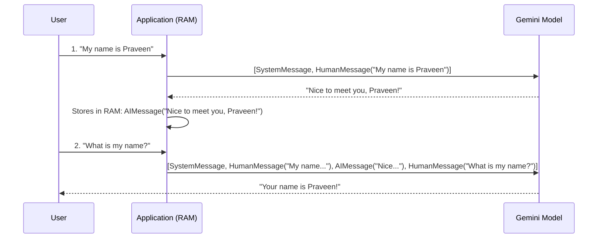
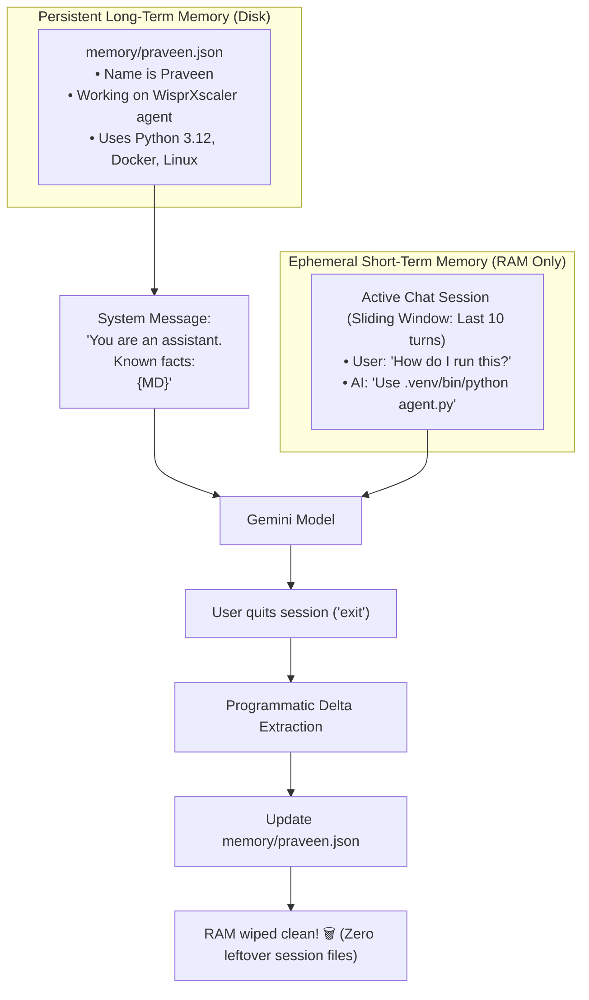
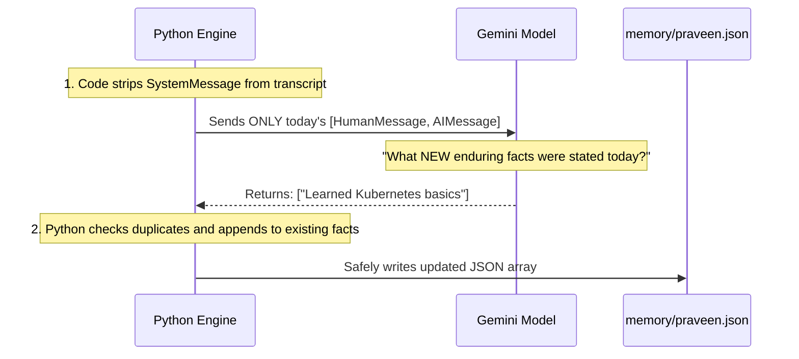
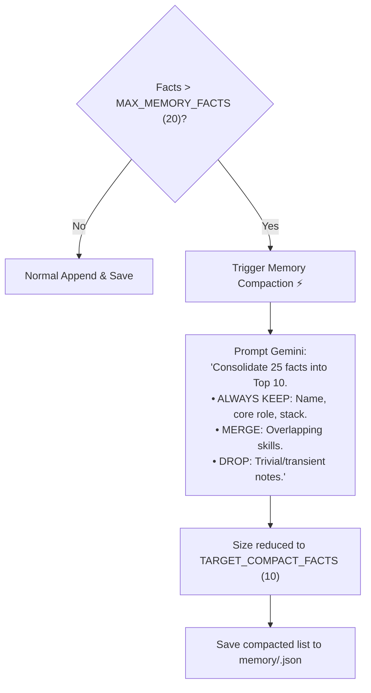

# AI Agent Memory Architecture Guide

A comprehensive architectural reference explaining how conversational memory works in AI agents, the transition from heavy databases to plain-text storage, and the **Ephemeral Session + Persistent Markdown Memory Pattern** with automatic **Memory Compaction**.

---

## 📌 1. The Core Principle: LLMs Are Stateless

Large Language Models (Gemini, GPT, Claude) possess **no natural memory**. Every request sent to the model API is completely isolated.

To simulate continuous conversation, the application maintains context by sending accumulated message history on each turn:



---

## 💬 2. LangChain Message Primitives

In LangChain, memory is a Python `list` containing three core message objects:

| Message Class | Role | Purpose |
| :--- | :--- | :--- |
| **`SystemMessage`** | System | Sets persona, instructions, and injects long-term user memory (`memory/<user_id>.md`). |
| **`HumanMessage`** | User | Represents inputs typed by the user. |
| **`AIMessage`** | Assistant | Represents past model answers. |

---

## ⚖️ 3. Native JSON List Storage vs. Heavy Databases

When starting to build AI agents, developers often reach for complex relational databases (PostgreSQL) or complicated parsing logic. 

Storing facts directly as a **native JSON array of strings (`memory/<user_id>.json`)** provides the cleanest balance:

```json
[
  "Name is Praveen",
  "Working on WisprXscaler AI agent",
  "Uses Python 3.12 and Docker"
]
```

| Factor | Relational DB (SQL) | Native JSON Array (`<user_id>.json`) |
| :--- | :--- | :--- |
| **Parsing Overhead** | SQL connections, schemas, migrations | **Zero overhead:** Native `json.loads` / `json.dumps` |
| **Deduplication** | Complex SQL constraints | Direct Python set lookups (`if fact not in existing`) |
| **Prompt Injection** | Database queries | Direct join: `"\n".join(f"- {f}" for f in facts)` |
| **Storage Footprint** | External service running | Single file, typically **< 2 KB** forever |

---

## 🧠 4. The Two-Tier Architecture: Ephemeral Session + Persistent Memory

Saving every conversation turn to disk creates unmanageable disk clutter and privacy concerns. The modern standard separates memory into two distinct tiers:



1. **Short-Term (Ephemeral RAM):**
   - Active messages live **only in RAM**.
   - A sliding window (e.g. `MAX_SHORT_TERM_TURNS = 10`) caps token usage during the chat.
   - When the user quits, the raw conversation is deleted from memory.

2. **Long-Term (Persistent Disk):**
   - Stored in a single file: `memory/<user_id>.json`.
   - On startup, read and injected directly into `SystemMessage`.

---

## 🛡️ 5. Programmatic Separation vs. The "Telephone Game" Flaw

### The Flaw of Pure Prompt-Based Re-summarization
If you pass the **entire message history** (System prompt + Old Memory + Today's chat) and ask an LLM:
> *"Summarize everything into a new memory file."*

Over multiple sessions, the model suffers from **Lossy Compressive Drift (The Telephone Game)**:
- **Session 1:** You mention your name is Praveen and you like pizza.
- **Session 2:** You talk exclusively about Docker debugging. The model focuses on Docker and **forgets the pizza**.
- **Session 5:** Early facts, personal preferences, and subtle details vanish completely.

### The Solution: Deterministic Programmatic Extraction
In production engineering:
> **"Never trust an LLM prompt to do what deterministic Python code can guarantee."**



* **Existing facts are never touched or hallucinated away.**
* The LLM performs a single, tightly-bounded task: finding *new* facts.
* Python handles deduplication and file writing deterministically.

---

## 🧹 6. Memory Compaction Algorithm (Halving Size at Scale)

What happens when `memory/<user_id>.json` keeps growing over months? If it reaches 50+ items, it consumes too many prompt tokens.

To prevent bloat, the engine uses **Memory Compaction / Consolidation**:



### Compaction Rules:
1. **Soft Threshold:** Set at `MAX_MEMORY_FACTS = 20`.
2. **Target Reduction:** Halves memory down to `TARGET_COMPACT_FACTS = 10`.
3. **Core Anchor Protection:** Prompt enforces keeping foundational identity (name, primary role, core tech stack) while pruning temporary notes or merging repetitive skills.

---

## 📁 7. Resulting Workspace Structure

```text
langchainAgent/
├── memory/
│   └── praveen.json        # The ONLY memory file (Native JSON array)
├── .dockerignore           # Excludes memory/ and .env from Docker image
├── .env                    # API keys (GOOGLE_API_KEY)
├── Dockerfile              # Container specification
├── agent.py                # Ephemeral agent loop + Compaction engine
├── docs/
│   └── MEMORY_ARCHITECTURE.md  # Architectural reference
└── requirements.txt        # Dependencies
```
